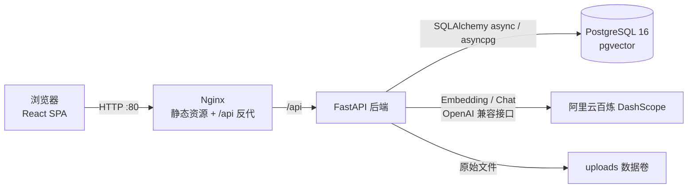

# personal-kb-rag

个人知识库 RAG 全栈应用：上传 PDF / DOCX / Markdown / TXT 文档，自动解析、分块并向量化入库，基于知识库进行带引用溯源的流式问答。

## 功能特性

- **登录鉴权**：账号密码登录，JWT 鉴权，未登录自动跳转登录页
- **知识库管理**：创建 / 重命名 / 删除知识库，删除时级联清理文档与向量
- **文档处理**：上传（≤20MB）→ 解析 → 段落优先分块（500 字窗口 / 50 字重叠）→ Embedding 入库，异步执行并回写处理状态
- **RAG 问答**：pgvector 余弦相似度 TopK 检索，SSE 流式输出，回答附可展开的引用来源
- **会话管理**：多会话、历史消息加载、重命名与删除

## 系统架构



请求链路：前端静态资源由 Nginx 托管，`/api` 请求反向代理到后端（SSE 关闭缓冲）；后端启动时自动执行建库脚本并写入初始管理员。

## 技术栈

| 层次 | 技术 |
| --- | --- |
| 前端 | React 18、TypeScript、Vite、Tailwind CSS、react-router、react-markdown |
| 后端 | FastAPI、SQLAlchemy 2.x（async）、asyncpg、httpx |
| 数据库 | PostgreSQL 16 + pgvector（`embedding vector(1024)` + ivfflat 索引） |
| 大模型 | 阿里云百炼 DashScope（qwen 系列对话模型 + text-embedding-v3） |
| 部署 | Docker Compose（postgres / backend / frontend 三服务） |

## 目录结构

```
├── app/                  # FastAPI 后端（routers / services / models / schemas）
├── scripts/schema.sql    # 建库脚本（启动时自动执行）
├── frontend/             # React 前端（Dockerfile + nginx.conf 用于镜像构建）
├── tests/                # pytest 测试
├── Dockerfile            # 后端镜像
├── docker-compose.yml    # 一键部署编排
└── .env.example          # 环境变量模板
```

## 快速开始

### 方式一：Docker Compose 一键启动（推荐）

前置要求：Docker + Docker Compose。

```bash
# 1. 准备环境变量
cp .env.example .env

# 2. 编辑 .env，至少填写：
#    POSTGRES_PASSWORD、JWT_SECRET、INITIAL_ADMIN_PASSWORD、DASHSCOPE_API_KEY

# 3. 构建并启动三个服务
docker compose up -d --build

# 4. 查看启动状态（frontend 健康后才可访问）
docker compose ps
```

启动完成后访问 `http://localhost`（端口可用 `.env` 中的 `FRONTEND_PORT` 调整），用 `.env` 中配置的初始管理员账号登录。

- 后端容器内的 `DATABASE_URL` 由 compose 自动拼装为 `postgres` 服务地址，无需手工修改
- 首次启动自动建表，并按 `INITIAL_ADMIN_USERNAME` / `INITIAL_ADMIN_PASSWORD` 写入管理员（已存在则跳过）
- 停止：`docker compose down`；连同数据卷一起清空：`docker compose down -v`

### 方式二：本地开发

前置要求：Python 3.11+、Node.js 20+、Docker。

```bash
# 1. 仅启动数据库
docker compose up -d postgres

# 2. 后端（仓库根目录）
python -m venv .venv
.venv\Scripts\Activate.ps1        # macOS / Linux：source .venv/bin/activate
pip install -r requirements.txt

# 复制 .env.example 为 .env，保持 DATABASE_URL 指向 localhost，并填写密钥
uvicorn app.main:app --reload --port 8000

# 3. 前端（另开终端）
cd frontend
npm install
npm run dev                       # http://localhost:5173，/api 自动代理到 127.0.0.1:8000
```

## 环境变量说明

所有敏感项均通过环境变量注入，代码中不含真实值；`.env` 不入库。

| 变量 | 必填 | 说明 | 默认值 |
| --- | --- | --- | --- |
| `POSTGRES_USER` | 否 | 数据库用户名 | `postgres` |
| `POSTGRES_PASSWORD` | **是** | 数据库密码 | 无 |
| `POSTGRES_DB` | 否 | 数据库名 | `personal_kb` |
| `POSTGRES_PORT` | 否 | 数据库映射到宿主机的端口 | `5432` |
| `DATABASE_URL` | 本地开发必填 | 后端异步连接串（Docker 内由 compose 自动覆盖） | 无 |
| `JWT_SECRET` | **是** | JWT 签名密钥（随机长字符串） | 无 |
| `JWT_EXPIRE_MINUTES` | 否 | 登录态有效期（分钟） | `1440` |
| `INITIAL_ADMIN_USERNAME` | 否 | 初始管理员用户名 | `admin` |
| `INITIAL_ADMIN_PASSWORD` | **是** | 初始管理员密码 | 无 |
| `DASHSCOPE_API_KEY` | 建议 | 百炼 API Key；未配置时 AI 接口返回友好提示 | 空 |
| `DASHSCOPE_BASE_URL` | 否 | 百炼 OpenAI 兼容接口地址 | `https://dashscope.aliyuncs.com/compatible-mode/v1` |
| `CHAT_MODEL` | 否 | 对话模型 | `qwen-plus` |
| `EMBEDDING_MODEL` | 否 | Embedding 模型（维度须为 1024） | `text-embedding-v3` |
| `CORS_ORIGINS` | 否 | 允许跨域来源，逗号分隔 | `http://localhost:5173,http://127.0.0.1:5173` |
| `UPLOAD_DIR` | 否 | 上传文件存储目录（容器内为 `/app/uploads`） | `uploads` |
| `UPLOAD_MAX_MB` | 否 | 单文件大小上限（MB） | `20` |
| `FRONTEND_PORT` | 否 | 前端映射到宿主机的端口 | `80` |
| `APP_NAME` / `DEBUG` | 否 | 应用名 / 调试模式 | `personal-kb-rag` / `false` |

### 数据持久化

- `pgdata` 卷：PostgreSQL 数据
- `uploads` 卷：上传的原始文档

## API 概览

统一返回结构 `{"code": int, "message": str, "data": any}`，除登录与健康检查外均需 `Authorization: Bearer <token>`。

| 方法 | 路径 | 说明 |
| --- | --- | --- |
| GET | `/api/health` | 健康检查（部署探活） |
| POST | `/api/auth/login` | 账号密码登录 |
| GET | `/api/auth/me` | 当前登录用户 |
| GET/POST | `/api/knowledge-bases` | 知识库列表 / 创建 |
| PUT/DELETE | `/api/knowledge-bases/{kb_id}` | 重命名 / 删除知识库 |
| GET/POST | `/api/knowledge-bases/{kb_id}/documents` | 文档列表 / 上传 |
| GET/DELETE | `/api/documents/{document_id}` | 文档详情（含分块）/ 删除 |
| GET/POST | `/api/chat-sessions` | 会话列表 / 新建 |
| PUT/DELETE | `/api/chat-sessions/{session_id}` | 重命名 / 删除会话 |
| GET | `/api/chat-sessions/{session_id}/messages` | 历史消息 |
| POST | `/api/chat-sessions/{session_id}/ask` | 流式问答（SSE） |

## 功能截图

> 以下为截图位，后续补充实际界面截图。

| 登录页 | 知识库管理 |
| --- | --- |
|  |  |

| 文档管理 | 流式问答 |
| --- | --- |
|  |  |

## 测试与构建

```bash
# 后端（需可用的 DATABASE_URL 与 DashScope Key）
pytest

# 前端类型检查 + 产物构建
cd frontend && npm run build
```

## 常见问题

- **AI 接口提示未配置**：`.env` 中 `DASHSCOPE_API_KEY` 为空，配置后重启后端容器
- **80 端口被占用**：在 `.env` 中设置 `FRONTEND_PORT=8080` 后重新 `docker compose up -d`
- **问答无增量输出**：确认请求经过的是 Nginx 的 `/api` 反代（已关闭 `proxy_buffering`）
- **文档一直处于处理中**：查看后端日志 `docker compose logs -f backend`，Embedding 调用失败会回写失败原因
- **构建时无法拉取基础镜像（registry-1.docker.io 超时）**：国内网络可先为 Docker 配置镜像加速器，或先从镜像源拉取 `python:3.11-slim`、`node:20-alpine`、`nginx:1.27-alpine` 并 `docker tag` 成本地同名镜像后再构建
- **修改 `POSTGRES_PASSWORD` 后后端报密码认证失败**：密码仅在数据卷首次初始化时生效，已有 `pgdata` 卷需进入数据库同步修改密码，或 `docker compose down -v` 清空数据后重建

## License

[MIT](LICENSE)
